# ПРИМС:КА - Расширение стандарта ПРИМС для детерминированных конечных автоматов

**Версия документа:** 0.2 (2026-10-26)

**English title:** Extended Hierarchical State Machine Programming - Deterministic Finite
Automaton Extensions

**Ключевые слова:** автомат Мили, автомат Мура, детерминированный конечный автомат,
конечный автомат, конечный автомат с выходом, машина состояний, программирование
расширенных иерархических машин состояний, ПРИМС

## 1. Введение

Этот документ описывает стандарт для отображения и хранения диаграмм детермнированных
конечных автоматов с целью их рисования и последующего исполнения. Документ является
расширением стандартов ПНСТ 984-2024 и ПНСТ 1044-2025, описывающих диаграммы расширенных
иерархических машин состояний (РИМС) и их программирование (ПРИМС), а также формат
сериализации диаграмм CyberiadaML-GraphML 1.0, основанный на XML/GraphML.

**Машины состояний** (finite state machines) и **конечные автоматы** (finite automaton)
часто рассматриваются как синонимы, представляющие собой абстрактные машины, выполняющие
определенные действия на основе входных данных. Для данного документа принципиально
различить машины состояний и конечные автоматы.

**Машины состояний** рассматриваются в стандартах Национальной киберфизической платформы в
контексте решения задач управления и связанного с этим программирования. Если нужно
выделить различные состояния управляемого процесса (состояния системы, протокола,
автономного агента и пр.) и сменять их в результате происходящих событий, машины состояний
в их богатой реализации ПРИМС являются адекатным инструментом. Особенно выгодным
становится применение диаграмм ПРИМС в работе с открытыми средами со слабо
структурированными происходящими в них событиями.

**Конечные автоматы** рассматриваются нами в данном стандарте в более строгой ситуации
использования – при анализе входной цепочки символов и, возмножно, производсте выходной
цепочки согласно заданной системе правил (состояний и связей между ними). Таким образом,
конечные автоматы являются способом распознавать цепочки символов, принадлежащие
регулярным языкам. В данном документе рассматриваются только детерминированные конечные
автоматы.

Строго определенные таким образом конечные автоматы структурно являются подмножеством
РИМС: диаграмма конечного автомата — диаграмма ПРИМС, составленная из ограниченного набора
элементов (раздел 3). Исполняется она по семантике конечного автомата (раздел 2.4), которая
совпадает с семантикой ПНСТ 984-2024 для диаграмм детерминированных конечных автоматов.

## 2. Определение детерминированного конечного автомата

Конечный автомат как абстрактная машина представляет собой устройство (см. рисунок 1),
состоящее из:

- входной ленты с символами входного алфавита `A` и устройства, считывающего текущий
  символ на ленте;
- блока управления, который может находиться только в одном состоянии из заданного конечного
  набора;
- если это **автомат с выходом**, то выходной ленты с символами алфавита `B` и
  устройства для последовательной записи символов на выходную ленту.

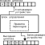

### 2.1. Математическое определение конечного автомата

Математически конечные автоматы задаются пятеркой вида:

```
F = (A, Q, q0, QF, δ),
```

где `A` — алфавит входных символов, `Q` — конечное множество состояний, `q0 ∈ Q` —
начальное состояние автомата, `QF ⊆ Q` — множество конечных состояний автомата, `δ`
— множество правил переходов. Каждое правило переходов имеет вид `p a → q`, где `p, q ∈ Q` —
некоторые состояния, которые могут совпадать, `a ∈ A` — входной символ, принадлежащий
заданному алфавиту.

Если на каком-то шаге исполнения блок управления находится в состоянии `p`, а считывающее
устройство наблюдает символ `a` на входной цепочке, то результатом действия этого правила
станет изменение состояния автомата на `q` и сдвиг считывающего устройства на один
символ. Таким образом, автомат меняет своё состояние от начального к одному из конечных,
последовательно читая символы на входной ленте.

В данном стандарте рассматриваются только **детерминированные** конечные автоматы, то есть
такие конечные автоматы, который определяет самое большее один переход для каждого
состояния и каждого символа входного символа. Другими словами, в детерминированном
автомате невозможна ситуация конфликта при выборе правила перехода.

Говорят, что цепочка входных символов **допускается конечным автоматом**, если в
результате работы автомата она прочитывается целиком, а автомат после этого находится в
одном из конечных состояний. В противном случае, говорят, что цепочка не допускается
данным автоматом.

Для отображения конечного автомата используется **ориентированный граф**, вершины которого
соответствуют состояниям автомата, а дуги — правилам переходов. При этом дуга из вершины
`q1` в вершину `q2` имеет метку `a` тогда и только тогда, когда автомат содержит правило
перехода `q1 a → q2`, т.е. метками дуг могут быть символы входного алфавита. Пример
диаграммы конечного автомата показан на рисунке 2:

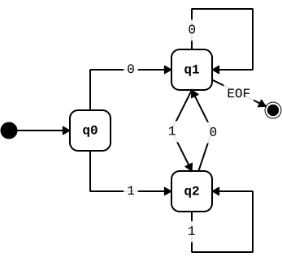

Данный стандарт посвящен отображению и хранению диаграмм детерминированных конечных
автоматов.

### 2.2. Конечные автоматы с выходом

Существует два определения конечных автоматов с выходом — т.н. **автоматы Мили** и
**автоматы Мура**.

В **автоматах Мили** выходные символы производятся на переходах. Математически такие
конечные автоматы с выходом задаются шестеркой вида:

```
FE1 = (A, B, Q, q0, f, g1),
```

где `A` — алфавит входных символов, `B` — алфавит выходных символов (может в частном
случае совпадать с входным), `Q` — конечное множество состояний, `q0 ∈ Q` — начальное
состояние автомата, `f: Q × A → Q` — функция переходов, аналогичная `δ`, определенной
выше. `g1: Q × (B ∪ {λ}) → Q` — функция выходов, определяющая, какой символ будет получен
на выход на каждом шаге работы автомата. В `g1` каждому ребру перехода между состояниями
(согласно входному символу) соответствует выходной символ `b ∈ B ∪ {λ}`, в
т.ч. специальный символ `λ` (лямбда), если выход для данного перехода отсутствует.

В обобщем виде функцию переходов автмата Мили можно обозначить так
`f1: Q × A → Q × (B ∪ {λ})`, т.е. с правилами вида `p a → q / b`, где `a` — символ входного
алфавита, `b` — символ выходного алфавита или `λ`.

В **автоматах Мура** выходные состояния производятся в текущих состояниях. Математически
это определяется следующим образом:

```
FE2 = (A, B, Q, q0, f, g2),
```

в которой функция выходов определена по-другому `g2: Q → B ∪ {λ}`, то есть каждому состоянию в
соответствие ставится выходной символ `b ∈ B ∪ {λ}`.

Рассмотрим простой автомат, обращающий битовую строку, то есть преобразующий каждый символ
алфавита `{0, 1}` в противоположный. Примеры диаграмм для автоматов Мили и Мура
соответственно показаны на следующих рисунках:

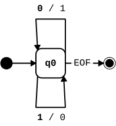

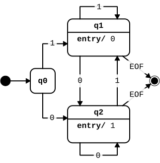

### 2.3. Обобщенное определение, принятое в данном стандарте

В данном стандарте используется обобщенное определение конечного автомата, которое включает не
только алфавит входных и выходных символов (может быть опущен), одно начальное состояние и
множество конечных состояний, но и возможность описывать правила выхода как на переходах,
так и на состояниях. Математически это определение можно дать следующим образом:

```
FA = (A, B, Q, q0, QF, f1, g2),
```

составляющие множества и функции которого были определены выше.

### 2.4 Семантика исполнения

Диаграмма ПРИМС с параметром метаданных `type/fa` исполняется исполнителем конечного
автомата:

- конфигурация исполнения — множество активных состояний; начальная конфигурация —
  состояние `q0` с выполнением действий входа этого состояния, если они заданы;
- для очередного символа `a` входной ленты каждое активное состояние дает по одному
  прогону на каждый применимый переход по `a` — собственный или унаследованный от
  родительского состояния (переход вложенного состояния по `a` замещает переход родителя
  по `a`, см. ПНСТ 984-2024);
- исполнение, для которого не существует перехода по символу, прекращается;
- после последнего символа исполнитель передает событие `EOF`; цепочка допускается, если
  хотя бы один прогон перешел по `EOF` в конечное состояние;
- выход данного исполнения — последовательность символов действий переходов и действий
  входа в порядке, заданном ПНСТ 984-2024.
  
Детерминированная диаграмма может исполняться диспетчером ПРИМС по ПНСТ 984-2024 с тем же
результатом, если исполнитель ленты считает отброшенный символ недопуском цепочки.

Недетерминированные диаграммы допускается рисовать и хранить, но для исполнения диаграммы
их необходимо предварительно детерминизировать.

## 3. Соответствие диаграммы конечного автомата стандарту ПРИМС

В данном разделе показывается соответствие элементов диаграмм конечных автоматов и элементов
диаграммы ПРИМС, тем самым утверждается, что конечный автомат может быть представлен как
подмножество диаграммы машины состояний, описываемой стандартом ПНСТ 984-2024.

Все элементы ПРИМС, не указанные в данном разделе, недопустимы в диаграммах конечных
автоматов.

| Элемент КА | Элемент ПРИМС | Пример изображения на диаграмме |
|---|---|---|
| Состояние | Простое состояние | 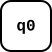 |
| Состояние с выходом | Простое состояние с входным действием | 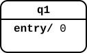 |
| Начальное состояние | Начальное псевдосостояние и переход в состояние | 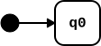 |
| Конечное состояние | Конечное состояние и переход в него по символу `EOF` | 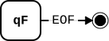 |
| Переход | Внешний переход | 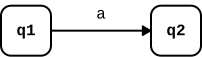 |
| Переход с выходом | Внешний переход с действием | 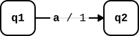 |

Далее более подробно разбираются особые случаи соответствия диаграмм.

Элементы ПРИМС, отсутствующие явно в данном стандарте, не допустимы (например,
ортогональные области, состояния выбора и пр.).

### 3.1. Состояния

Состояния в диаграммах конечных автоматов могут отображаться как состояния в ПРИМС – в
виде прямоугольников со скругленными краями. Также допускается изображение состояний в
виде прямоугольников и овалов. Использование окружностей и овалов для обозначения
состояний явно противоречит требованиям стандарта ПНСТ 984-2024, однако такое визуальное
отображение конечных автоматов широко используется на практике. Поэтому исключение может
быть сделано для визуального отображения конечных автоматов, в то время как геометрия этих
элементов по-прежнему должна быть представлена прямоугольником. Рекомендуется использовать
единообразное обозначение для простых и составных состояний в диаграмме конечного
состояния.

Имя состояния отображается в диаграмме конечного автомата так же, как в диаграмме
ПРИМС. На имена состояний конечных автоматов распространяются те же требования по
именованию, что и в стандарте ПРИМС.

В конечных автоматах с выходом в состоянии может быть указан символ выходного алфавита, в
этом случае он указывается как **действие входа** в этом состоянии. При отображении
диаграмм конечных автоматов зарезервированное название действий входа `entry/` может быть
опущно, а указано только содержание самого действия — выходной символ. Но в описании
диаграммы в формате CyberidaML-GraphML указывать действие входа (`entry/`) необходимо в
соответствии со стандартом ПРИМС.

При наличии действия выхода в состоянии, он выполняется после действия на переходе,
приведшем к данному состоянию в соответствием с правилами исполнения диаграмм ПРИМС,
описанных в стандарте ПНСТ 984-2024.

Примеры допустимых обозначений состояний конечных автоматов:


#### 3.1.1. Составные состояния

Диаграммы ПРИМС допускают иерархию состояний. Иерархия состояний – это способ сократить
количество переходов в диаграмме за счет обобщения переходов к/от родительских
состояний. По этой причине диаграмме с составными состояниями можно поставить в
однозначное соответствие диаграмму без составных состояний.

По этой причине составные состояния – их обозначение и семантика **допустимы** для
использования в диаграммах конечных автоматов.

Составные состояния конечного автомата не может содержать действия входа.

### 3.2. Начальные псевдосостояния

В диаграмме конечного автомата, как и в диаграмме ПРИМС, должно быть определено только
одно начальное псевдосостояние на верхнем уровне диаграммы.

Помимо этого начальные псевдосостояния могут использоваться в составных состояниях
(см. раздел 3.1.1).

Переход из начального состояния не переходом с точки зрения правил перехода конечного
автомата, хотя и обозначается похожим образом.

### 3.3. Конечные состояния

Поскольку конечные состояния в конечных автоматах и машинах состояний отличаются (к
примеру, в ПРИМС недопустимы переходы из конечных состояний, в т.ч. петли), для
обозначения конечных состояний конечного автомата на языке ПРИМС необходима специальная
конструкция из двух элементов:
- собственно конечное состояние ПРИМС;
- дополнительный переход в это конечное состояние по специальному символу конца ленты
  `EOF` (см. раздел 3.4.1).

Конечные состояния не могут использоваться в составных состояниях.

### 3.4. Переходы

В диаграммах конечных автоматов допустимы только внешние переходы. На внешнем переходе
может быть указано событие – символ входного алфавита или специальное событие (см. раздел
3.4.1). В детерминированном конечном автомате запрещается использовать более одного выхода
из состояния по одному и тому же символу.

В диаграмме детерминированного конечного автомата переход без указания входного символа
(события) не допустим. 

Внутренние переходы по символу имеют приоритет перед переходами по тому же символу из
родительских состояний.

Если диаграмма описывает конечный автомат с выходом, может быть указано действие на
переходе, содержащее символ выходного алфавита.

#### 3.4.1. Специальные события на переходах

Диаграммы конечных автоматов требуют явного введения специального события: `EOF` –
событие, соответствующее концу ленты, то есть переход произойдет, только если входная
 лента подошла к концу.

Событие `EOF` должно генерироваться платформой исполнения конечного автомата.

Специальные события `ANY` и `UNKNOWN`, упоминаемые в стандарте ПРИМС, недопустимы в диаграммах
конечных автоматов, если не были заданы явно в описании входного алфавита. Не
допустимо использовать зарезервированные имена для символов входного алфавита
(событий): `do`, `else`, `entry`, `exit`, `propagate`, `block`, `defer` и др.

### 3.5. Комментарии

Диаграммы конечных автоматов допускают комментарии и связи комментариев через предметы
комментирования, используемые в стандарте ПРИМС.

В диаграммах конечных автоматов могут использоваться как неформальные, так и формальные
комментарии. Формальные комментарии могут использоваться для описания входных и выходных
алфавитов (см. раздел 4).

## 4. Определение входного и выходного алфавита

Входной и выходной алфавиты конечного автомата могут быть определены в диаграмме. Для этого
нужно использовать формальные комментарии со стандартными именами:

- `FA_INPUT` или `FA_INPUT_RE` – имя формального комментария с описанием входного алфавита
  конечного автомата (может использоваться только один комментарий);
- `FA_OUTPUT` или `FA_OUTPUT_RE` – имя формального комментария с описанием выходного
  алфавита конечного автомата (может использоваться только один комментарий).

Данные формальные комментарии должны быть расположены на верхнему уровне машины состояний,
там же, где расположен `CGML_META`. Данные формальные комментарии могут не иметь геометрии.

Тело формального комментария содержит допустимые символы алфавита, разделенные символом
конца строки (↳). В описании входного алфавита специальные символы не указываются
(см. раздел 3.4.1).

Пример описания выходного алфавита:

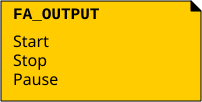

При описании допустимых символов входного и выходного алфавита можно использовать
ограниченные регулярные выражения. В этом случае имя формального комментария, задающего
алфавит, должно заканчиваться на `_RE`.

При описании алфавита с использованием регулярных выражений в строке вместо символа
указывается регулярное выражение, кодирующее **конечное** множество символов, входящее в
данный алфавит. Допустимые конструкции регулярного выражения:

- `.` – любой символ данного алфавита;
- `[a-z]` – диапазон символов от `a` до `z`;
- `{n}` – модификатор в `n` повторений;
- `{n, m}` – модификатор повторений от `n` до `m`;
- `?` – модификатор для 0-1 повторения;
- `(START|STOP)` – скобки и символ альтернативы.

Обратите внимание, что символы регулярных выражений `*`, `+`, `^`, `$` не используются,
поэтому порождаемое множество символов будет конечно.

При использовании описания с регулярными выражениями использование служебных символов –
`.`, `[`, `]`, `-`, `{`, `}`, `,`, `?`, `(`, `)`, `|` – для задания символов алфавита должны
предваряться символом обратной косой черты `\`, а сама обратная косая черта кодируется
двумя такими символами подряд `\\`.

Регулярные выражения могут использоваться исключительно в формальном комментарии для
задания алфавита. На описании переходов и действий могут быть обозначены только строки,
являющиеся результатом исполнения регулярного выражения.

Пример описания входного алфавита с регулярными выражениями:

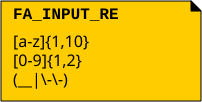

## 5. Определение конечного автомата в формате CyberiadaML-GraphML

Диаграмма конечного автомата описывается форматом CyberiadaML-GraphML версии 1.0. Для
этого в метаданных документа (в формальном комментарии `CGML_META`) должен быть указан
параметр `type` со значением `fa`. Пример:

```xml
<node id="coreMeta">
<data key="dNote">formal</data>
<data key="dName">CGML_META</data>
<data key="dData">
standardVersion/1.0↳
↳
type/fa↳
↳
geometry/short↳
</data>
</node>
```

Все элементы диаграммы конечного автомата представляются соответствующим стандарту ПНСТ
1044-2025 образом включая описание геометрии.

## 6. Литература

- Белоусов А.И., Ткачев С.Б. Дискретная математика: учебник для втузов. М. : Изд-во МГТУ
  им. Н. Э. Баумана, 2004.
- Стандарт ПНСТ 984-2024. Системы киберфизические. Национальная киберфизическая
  платформа. Часть 3. Программирование расширенных иерархических машин состояний
- Стандарт ПНСТ 1044-2025. Системы киберфизические. Национальная киберфизическая
  платформа. Часть 4. Программирование расширенных иерархических машин состояний. Формат
  документа описания диаграмм машин состояний
