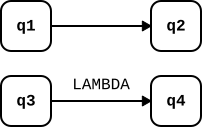

# ПРИМС - Расширение для конечных автоматов

**Версия документа:** 0.1 (2026-10-25)

**English title:** Extended hierarchical state machine programming - Finite automaton extensions

**Ключевые слова:** автомат Мили, автомат Мура, конечный автомат, конечный автомат с
выходом, машина состояний, программирвоание расширенных иерархических машин состояний,
ПРИМС

## 1. Введение

Этот документ описывает стандарт для отображения и храниния диаграмм конечных автоматов с
целью их рисования и последующего исполнения. Документ является расширением стандартов
ПНСТ 984-2024 и ПНСТ 1044-2025, описывающих диаграммы расширенных иерархических машин
состояний (РИМС) и их программирование (ПРИМС), а также формат сериализации диаграмм
CyberiadaML-GraphML 1.0, основанный на XML/GraphML.

**Машины состояний** (finite state machines) и **конечные автоматы** (finite automaton)
часто рассматриваются как синонимы, представляющие собой абстрактные машины, выполняющие
определенные действия на основе входных данных. Для данного документа приципиально
различить машины состояний и конечные атоматы.

**Машины состояний** рассматриваются в стандартах Национальной киберфизической платформы в
контексте решения задач управления и связанного с этим программирования. Если нужно
выделить различные состояния управляемого процесса (состояния системы, персонажа,
протокола и пр.) и сменять их в результате происходящих событий, машины состояний в их
богатой реализации ПРИМС хорошо подходят. Особенно выгодным становится применение диаграмм
ПРИМС в работе с открытыми средами и слабо структурированными происходящими событиями.

**Конечные автоматы** рассматриваются нами в данном стандарте в более строгой ситуации
использования – при анализе входной цепочки символов и, возмножно, производсте выходной
цепочки согласно заданной системе правил (состояний и связей между ними). Таким образом,
конечные автоматы являются способом распознавать цепочки символов, произведенных
регулярными языками.

Строго определенные таким образом конечные автоматы являются подмножеством РИМС,
эффективно применяемым в определенном классе задач.

## 2. Определение конечного автомата

Конечный автомат как абстрактная машина представляет собой устройство (см. рисунок 1),
состоящее из:

- входной ленты с символами входногоалфавита `A` и устройства, считывающего текущий
  символ на ленте;
- блока управления, который может находиться только одном состоянии из заданного конечного
  набора;
- если это **автомат с выходом**, то выходной ленты с символами алфавита `B` и
  устройством для последовательной записи символов на выходную ленту.


Рисунок 1 - Конечный автомат как абстрактная машина

### 2.1. Математическое определение конечного автомата

Математически конечные автоматы задаются пятеркой вида:

```
F (A, Q, q0, QF, δ),
```

где `A` — алфавит входных символов, `Q` — конечное множество состояний, `q0 ∈ Q` —
начальное состояние автомата, `QF ⊆ Q` — множество конечных состояний автомата, `δ`
— множество правил переходов. Каждое правило переходов имеет вид `p a → q`, где `p, q ∈ Q` —
некоторые состояния, которые могут совпадать, `a ∈ A ∪ {λ}` — входной символ или пустое
слово (обозначается символом `λ` — греческой буквой лямбда).

Правило имеет следующий смысл:

- если `a ≠ λ`, то это правило применимо, только если на данном шаге блок управления
находится в состоянии `p`, а считывающее устройство наблюдает символ `a` на входной
цепочке. Результатом действия этого правила является изменение состояния автомата на `q` и
сдвиг считывающего устройства на один символ;
- если `a = λ`, то это правило применимо, только если на данном шаге блок управления
находится в состоянии `p`, символ на ленте при этом не анализируется (это возможно также,
если считывающее устройство дошло до конца ленты). Результатом действия этого правила
является изменение состояния автомата на `q`.

Таким образом, автомат меняет своё состояние от начального к одному из конечных,
последовательно читая символы на входной ленте.

Говорят, что цепочка входных символов **допускается конечным автоматом**, если в
результате работы автомата она прочитывается целиком, а автомат после этого находится в
одном из конечных состояний. В противном случае, говорят, что цепочка не допускается
данным автоматом.

Для отображения конечного автомата часто используют ориентированный граф, вершины которого
соответствуют состояниям автомата, а дуги — правилам переходов. При этом дуга из вершины
`q1` в вершину `q2` имеет метку a тогда и только тогда, когда автомат содержит правило
перехода `q1 a → q2` , т.е. метками дуг могут быть символы входного алфавита или символ
`λ`.

Для отображения конечного автомата используется **ориентированный граф**, вершины которого
соответствуют состояниям автомата, а дуги — правилам переходов. При этом дуга из вершины
`q1` в вершину `q2` имеет метку a тогда и только тогда, когда автомат содержит правило
перехода `q1 a → q2`, т.е. метками дуг могут быть символы входного алфавита или символ
λ. Пример диаграммы конечного автомата показан на рисунке 2:


Рисунок 2 - Пример диаграммы конечного автомата

Данный стандарт посвящен отображению и хранению диаграмм конечных автоматов.

### 2.2. Конечные автоматы с выходом

Существует два определения конечных автоматов с выходом — т.н. **автоматы Мили** и
**автоматы Мура**.

В **автоматах Мили** выходные символы производятся на переходах. Математически такие
конечные автоматы с выходом задаются пятеркой вида:

```
FE (A, B, Q, q0, f, g1),
```

где `A` — алфавит входных символов, `B` — алфавит выходных символов (может в частном
случае совпадать с входным), `Q` — конечное множество состояний, `q0 ∈ Q` — начальное
состояние автомата, `f: Q × A → Q` — функция переходов, аналогичная `δ`, определенной
выше. `g1: Q × B → Q` — функция выходов, определяющая, какой символ будет получен на выход
на каждом шаге работы автомата. В `g1` каждому ребру перехода между состояниями (согласно
входному символу или символу `λ`) соответствует выходной символ `b ∈ B ∪ {λ}`, в
т.ч. символ `λ`, если выход для данного перехода отсутствует.

В **автоматах Мура** выходные состояния производятся в текущих состояниях. Математически
это определятся следующим образом:

```
FE (A, B, Q, q0, f, g2),
```

в которой функция вывода определена по-другому `g2: Q → B`, то есть каждому состоянию в
соответствие ставится выходной символ `b ∈ B ∪ {λ}`.

Рассмотрим простой автомат, обращающий битовую строку, то есть преобразующий каждый символ
алфавита `{0, 1}` в противоположный. Примеры диаграмм для автоматов Мили и Мура показаны
на следующих рисунках:


Рисунок 3 – Пример диаграммы автомата Мили


Рисунок 4 – Пример диаграммы автомата Мура

### 2.3. Обобщенное определение, принятое в данном стандарте

В данном стандарте используется обобщенное определение конечного автомата и включает не
только алфавит входных и выходных символов (может быть опущен), одно начальное состояние и
множество конечных состояний, но и возможность описывать правила выхода как на переходах,
так и на состояниях.

## 3. Соответствие диаграммы конечного автомата стандарту ПРИМС

В данном разделе показывается соответствие элементов диаграмм машин состояний и элементов
диаграммы ПРИМС, тем самым утверждается, что конечный автомат может быть представлен как
подмножество диаграммы машины состояний, описываемой стандартом ПНСТ 984-2024.

Все элементы ПРИМС, не указанные в данном разделе, не допустимы в диаграммах конечных
автоматов.

| Элемент КА | Элемент ПРИМС | Пример изображения на диаграмме |
|---|---|---|
| Состояние | Простое состояние |  |
| Состояние с выводом | Простое состояние с входным действием |  |
| Начальное состояние | Начальное псевдосостояние |  |
| Конечное состояние | Переход в конечное состояние по символу `EOF` |  |
| Переход | Внешний переход |  |
| `λ`-переход | Внешний переход с символом `LAMBDA` или без указания символа |  |
| Переход с выходом | Внешний переход с действием |  |

Далее более подробно разбираются особые случаи соответствия диаграмм.

### 3.1. Состояния

Состояния в диаграммах конечных автоматов могут отображаться как состояния в ПРИМС – в
виде прямоугольников со скругленными краями. Также допускается изоражение состояний в виде
прямоугольников и овалов.

Имя состояния отображается в диаграмме конечного автомата так же, как в диаграмме ПРИМС. 

В конечных автоматах с выходом могут быть указан символ выходного алфавита, в этом случае
он указывается как **действие входа** в состоянии. При этом допустимо не отображать в
состоянии зарезирвированное название действий входа `entry/`, а указывать только
содержание самого действия.

### 3.1.1. Составные состояния

Диаграммы ПРИМС допускают иерархию состояний. Иерархия состояний – это способ сократить
количество переходов на диаграмме за счет обобщения переходов к/от родительских
состояний. По этой причине диаграмме с составными состояниями можно поставить в
однозначное соответствие диаграмму без составных состояний.

По этой причине составные состояния – их обозначение и семантика **допустимы** для
использвания в диаграммах конечных автоматов.

### 3.2. Начальные псевдосостояния

В диаграмме конечного автомата, как и в диаграмме ПРИМС, должно быть определено только
одно начальное псевдосостояние на верхнем уровне диаграммы.

Помимо этого начальные псевдосостояния могут использоваться в составных состояниях
(см. раздел 3.1.1). 

### 3.3. Конечные состояния

Поскольку конечные состояния в конечных автоматах и машинах состояний отличаются (к
примеру, в ПРИМС недопустимы переходы из конечных состояний, в т.ч, петли), для
обозначения конечных состояний конечного автомата на языке ПРИМС необходима специальная
конструкция из перехода по дополнительному переходу в собственно конечное состояние в
смысле ПРИМС по специальному символу конца ленты `EOF` (см. раздел 3.4.1).

### 3.4. Переходы

В диаграммах конечных автоматов допустимы только внешние переходы. На внешнем переходе
может быть указано событие – символ входного алфавита или специальное событие (см. раздел
3.4.1). 

Если диаграмма описывает конечный автомат с выходом, может быть указано действие на
переходе, содержащее символ выходного алфавита.

### 3.4.1. Специальные события на переходах

Диаграммы конечных автоматов требуют явного введения двух специальных событий:

- `LAMBDA` – событие, соответствующее `λ`-переходу, то есть переходу по любому символу без
  изменения текущего символа на входной ленте; в диаграммах конечных автоматов допустимы
  внешние переходы без символов, тогда они считаются переходами по событию `LAMBDA`;
- `EOF` – событие, соответствующее концу ленты, то есть переход произойдет, только если
  входная лента подошла к концу.

Также специальное событие `ANY`, определенное для диаграмм ПРИМС, может использоваться для
обозначения прочтения любого символа (не `λ`!) с входной ленты. 

Специальное событие `UNKNOWN`, определенное для диаграмм ПРИМС, недопустимо в диаграммах
конечных автоматов.

### 3.5. Комментарии

Диаграммы конечных автоматов допускают комментарии и связи комментариев через предметы
комментирования, используемые в стандарте ПРИМС.

В диаграммах конечных автоматов могут использоваться как неформальные, так и формальные
комментарии. Формальные комментарии могут использоваться для описания входных и выходных
алфавитов (см. раздел 4).

## 4. Определение входного и выходного алфавита

Входной и входной алфавит конечного автомата могут быть определены в диаграмме. Для этого
нужно использовать формальные комментарии со стандартными именами:

- `FA_INPUT` или `FA_INPUT_RE` – имя формального комментария с описанием входного алфавита
  конечного автомата;
- `FA_OUTPUT` или `FA_OUTPUT_RE` – имя формального комментария с описанием выходного
  алфавита конечного автомата.
  
Тело формального комментария содержит допустимые символы алфавита, раздеенные символом
конца строки (↳). В описании входного алфавита можно не указывать специальные символы
(см. раздел 3.4.1).

Пример описание выходного алфавита:


Рисунок 5 – Пример описания выходного алфавита

При описании допустимых символов входного и выходного алфавита можно использовать
ограниченные регулярные выражения. В этом случае имя формального комментария, задающего
алфавит, должно заканчиваться на `_RE`.

При описании алфавита с использованием регулярных выражений в строке вместо символа
указывается регулярное выражение, кодирующее **конечное** множество символов, входящее в
данный алфавит. Допустимые конструкции регулярного выражения:

- `.` – любой символ данного алфавита (эквивалентно событию `ANY`);
- `[a-z]` – диапазон символов от `a` до `z`;
- `{n}` – модификатор в `n` повторений;
- `{n, m}` – модификатор повторений от `n` до `m`;
- `?` – модификатор для 0-1 повторения;
- `(START|STOP)` – скобки с символом альтернативы.

При использовании описания с регулярными выражениями использование служебных символов –
`.`, `[`, `]`, `-`, `{`, `}`, `,`, `?`, `|` – для задания символов алфавита должны
предваряться символом обратной косой черты `\`, а сама обратная косая черта кодируется
двумя такими символами подряд `\\`.

Пример описания входного алфавита с регулярными выражениями:


Рисунок 6 – Пример описания входного алфавита с регулярными выражениями

## 5. Определение конечного автомата в формате CyberiadaML-GraphML

Диаграмма конечного автомата описывается форматом CyberiadaML-GraphML версии 1.0. Для
этого в метаданных документа (в формальном комментарии `CGML_META`) должен быть указан
параметр `type` со значением `fa`. Пример:

```xml
<node id="coreMeta">
<data key="dNote">formal</data>
<data key="dName">CGML_META</data>
<data key="dData">
standardVersion/1.0↳
↳
type/fa↳
↳
geometry/short↳
</data>
</node>
```

Все элементы диаграммы конечного автомата представляются соответствующим стандарту ПНСТ
1044-2025 образом включая описание геометрии.

## 6. Литература

- Белоусов А.И., Ткачев С.Б. Дискретная математика: учебник для втузов. М. : Изд-во МГТУ
  им. Н. Э. Баумана, 2004.
- Стандарт ПНСТ 984–2024. Системы киберфизические. Национальная киберфизическая
  платформа. Часть 3. Программирование расширенных иерархических машин состояний
- Стандарт ПНСТ 1044-2025. Системы киберфизические. Национальная киберфизическая
  платформа. Часть 4. Программирование расширенных иерархических машин состояний. Формат
  документа описания диаграмм машин состояний
