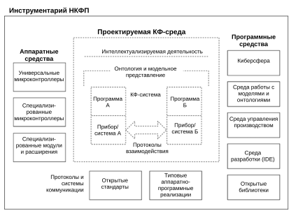
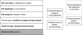
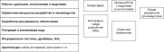
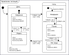
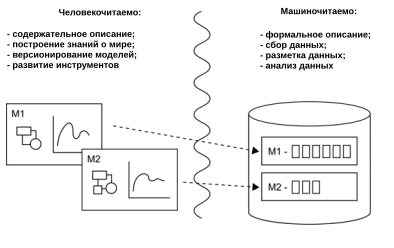
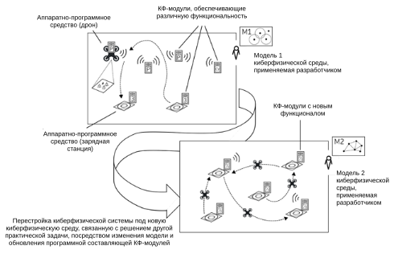
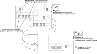

# Системы киберфизические. Национальная киберфизическая платформа. Часть 1. Общие положения

**English title:** Cyber-physical systems. National Cyber-Physical Platform. General
principles

**Ключевые слова:** системы киберфизические, национальная киберфизическая платформа, общие
положения

## 1 Область применения

Настоящий стандарт устанавливает общие положения (принципы) и архитектуру Национальной
киберфизической платформы и описывает применяемые программные и аппаратные средства.

Настоящий стандарт не устанавливает требований к шифрованию данных и к средствам
криптографической защиты информации.

## 2 Нормативные ссылки

В настоящем стандарте использованы нормативные ссылки на следующие стандарты:

* ГОСТ Р 59026 Информационные технологии. Интернет вещей. Протокол беспроводной передачи
  данных NB-IoT. Основные параметры
* ГОСТ Р 70036 Информационные технологии. Интернет вещей. Протокол беспроводной передачи
  данных на основе узкополосной модуляции радиосигнала (NB-Fi)
* ГОСТ Р 71168 Информационные технологии. Интернет вещей. Спецификация LoRaWAN RU
* ПНСТ 820–2023 Информационные технологии. Интернет вещей. Протокол передачи данных для
  высокоемких сетей на основе сверхузкополосной модуляции радиосигнала (OpenUNB)
* ПНСТ 983–2024 Системы киберфизические. Национальная киберфизическая платформа. Термины и
  определения

Примечание — При пользовании настоящим стандартом целесообразно проверить действие
ссылочных стандартов (сводов правил) в информационной системе общего пользования — на
официальном сайте Федерального агентства по техническому регулированию и метрологии в сети
Интернет или по ежегодному информационному указателю «Национальные стандарты», который
опубликован по состоянию на 1 января текущего года, и по выпускам ежемесячного
информационного указателя «Национальные стандарты» за текущий год. Если заменен ссылочный
документ, на который дана недатированная ссылка, то рекомендуется использовать действующую
версию этого документа с учетом всех внесенных в данную версию изменений. Если заменен
ссылочный документ, на который дана датированная ссылка, рекомендуется использовать версию
этого документа с указанным выше годом утверждения (принятия). Если после утверждения
настоящего стандарта в ссылочный документ, на который дана датированная ссылка, внесено
изменение, затрагивающее положение, на которое дана ссылка, то это положение рекомендуется
применять без учета данного изменения. Если ссылочный документ отменен без замены, то
положение, в котором дана ссылка на него, рекомендуется применять в части, не
затрагивающей эту ссылку.

## 3 Термины и определения

В настоящем стандарте применены термины и определения по ПНСТ 983–2024.

## 4 Сокращения

В настоящем стандарте применены следующие сокращения:

* **КФ** – киберфизический;
* **НКФП** – национальная киберфизическая платформа;
* **ПЛИС** – программируемая логическая интегральная схема;
* **САПР** – система автоматизированного проектирования;
* **ARM** – усовершенствованная RISC-машина (Advanced RISC Machine);
* **AVR** – 8-разрядный микроконтроллер, разработанный Atmel;
* **CAN** – стандарт промышленной сети (Controller Area Network);
* **DevOps** – подход к организации процессов разработки и эксплуатации программного
  обеспечения, направленный на сокращение времени между изменением кода и его внедрением в
  продуктивную среду;
* **HAL** – слой абстракции аппаратной реализации (Hardware Abstraction Layer);
* **I2C** – последовательная асимметричная шина для связи между интегральными схемами
  внутри электронных приборов (Inter-Integrated Circuit);
* **IDE** – интегрированная среда разработки программного обеспечения;
* **MIPS** – микропроцессор без блокировок в конвейере (Microprocessor without Interlocked
  Pipeline Stages);
* **RISC-V** – система команд и процессорная архитектура на основе концепции RISC;
* **STM32** – 32-разрядный микроконтроллер, разработанный STMicroelectronics;
* **UART** – универсальный асинхронный приемопередатчик (Universal Asynchronous
  Receiver-Transmitter);
* **USB** – универсальная последовательная шина (Universal Serial Bus).

## 5 Общие положения

НКФП предназначена для создания и поддержания киберфизических сред, включающих
киберфизические системы и отдельные устройства.

Киберфизическая среда представляет собой человеко-машинную, деятельностную систему,
имеющую в основании киберфизическую систему, и обладает следующими характеристиками:

- несет социальную функцию и общественную ценность;
- имеет гетерогенную и распределенную в пространстве структуру;
- обладает высоким уровнем автономности (самодостаточности) функциональных элементов;
- включает в себя каналы и протоколы связи между функциональными элементами;
- имеет систему управления, задающую логику взаимодействия элементов в опоре на
  модельно-онтологическое описание системы в целом;
- может проектироваться как модифицируемая в ходе реализации и эксплуатации и,
  следовательно, имеющая неопределенный заранее срок работы.

НКФП включает комплексную среду разработки, производства и последующей доработки
аппаратно-программных решений, призванных интеллектуализировать деятельность людей.
Концептуальная архитектура НКФП представлена в виде структурной схемы инструментария
(«верстака») разработчика киберфизических сред и систем (см. рисунок 1).

Инструменты НКФП можно разделить на три группы, составляющие единство киберфизических
систем:

- аппаратные средства (см. раздел 6);
- программные средства (см. раздел 7);
- протоколы и системы коммуникации (см. раздел 8).

Рисунок 1 – Концептуальная архитектура НКФП

Единство инструментария НКФП осуществляется посредством проектируемой киберфизической
среды, которая представлена через описание интеллектуализируемой деятельности и,
одновременно, через описание создаваемой киберфизической системы. Интеллектуализируемая
деятельность может быть представлена с помощью онтологического или модельного
представления, киберфизическая система — через аппаратные, программные и прочие
спецификации.

Группы инструментов и отдельные инструменты взаимосвязаны: аппаратные средства
программируются в предлагаемой интегрированной среде разработки, реализация моделей и
программных решений ограничена представленными модулями, протоколы и системы коммуникации
реализуются с помощью предлагаемых аппаратных и программных инструментов.

Типовые требования к архитектуре НКФП:

- прозрачность, открытость и документированность платформы, в том числе открытость
  спецификаций и кода программной части платформы;
- модульность и последовательное развитие платформы.

## 6 Аппаратные средства НКФП

### 6.1 Общие требования

Киберфизическая система, лежащая в основе киберфизической среды, может быть представлена в
виде уровней аппаратной реализации (см. рисунок 2), начиная с физического уровня
реализации до полноценных киберфизических систем. Физический уровень реализации в
настоящем стандарте не рассматривается.

Рисунок 2 – Уровни аппаратной реализации киберфизической системы в соотнесении с
аппаратными средствами НКФП

Над физическим уровнем располагается уровень архитектур микроконтроллеров (например,
MIPS), уровень реализации архитектур в виде семейств микроконтроллеров (например, серия
STM32 на архитектуре ARM), уровень отдельных киберфизических модулей и макросхем,
реализующих определенные функции киберфизических приборов и систем, и уровни
киберфизических приборов и киберфизических систем.

Аппаратные средства НКФП могут быть соотнесены с уровнями аппаратной реализации
киберфизических систем, как показано на рисунке 2.

В рамках НКФП должны быть обеспечены принципы открытости и модульности на всех уровнях
аппаратной реализации киберфизической системы:

- поддержка множества аппаратных архитектур, в том числе открытых (например, RISC-V), а
  также конкретных их реализаций в виде чипов от широкого круга производителей;
- обеспечение совместимости киберфизических модулей, связности отдельных приборов и
  компонентов киберфизических систем посредством открытых протоколов.

Указанные принципы реализуются за счет требований к открытости и документированности
архитектуры НКФП, расширяемости ее программных компонентов.

### 6.2 Универсальные микроконтроллеры

К универсальным микроконтроллерам НКФП относятся цифровые микросхемы, направленные на
решение широкого класса задач управления киберфизическими устройствами, обеспечивающие
базовые вычислительные возможности, совместимые с распространенными системами ввода-вывода
(такими как интерфейс UART, шины USB, I2C, CAN или их открытыми аналогами) и
программируемые с помощью языков высокого уровня (например, C). Универсальные
микроконтроллеры НКФП включают как существующие на международном рынке линейки
универсальных микроконтроллеров, таких как AVR Mega или STM32, и отечественные аналоги
таких линеек. Открытая архитектура универсальных микроконтроллеров НКФП позволяет
встраивать универсальные микроконтроллеры в широкую линейку киберфизических приборов и
систем, а также создавать новые киберфизические модули на их основе.

### 6.3 Специализированные микроконтроллеры

К специализированным микроконтроллерам НКФП относятся цифровые микросхемы, направленные на
решения специализированных задач, таких как обработка потокового видео, радиосвязь,
аппаратное ускорение графических вычислений или алгоритмов искусственного интеллекта, в
т.ч. программируемые с помощью языков высокого уровня. Специализированные микроконтроллеры
НКФП должны разрабатываться на базе открытых архитектур, что обеспечит совместимость таких
микроконтроллеров с универсальными микроконтроллерами, киберфизическими приборами и
системами.

### 6.4 Специализированные модули и расширения

На более высоких уровнях аппаратной реализации киберфизических систем представлены
специализированные киберфизические модули, реализуемые на базе доступных электронных
компонентов и обеспечивающие критическую функциональность киберфизических устройств и
систем. Киберфизические модули должны разрабатываться на базе открытых архитектур для
обеспечения совместимости с другими системами и дополнительной функциональности. Примеры
специализированных киберфизических модулей НКФП включают:

- универсальные модули управления питанием для устройств и систем;
- системы мониторинга и связи (включая прием, передачу, ретрансляцию с использованием
  существующих и разрабатываемых протоколов) для различных сред: радио, инфракрасный
  обмен, акустика и др.;
- контроллеры для умного дома или умного сельского хозяйства с набором необходимых
  интеллектуальных датчиков и подсистем управления, которые можно комбинировать с
  существующими на рынке решениями;
- модули для интерактивного взаимодействия носимых людьми и техникой (беспилотными
  аппаратами и др.) устройств — систем для игр и состязаний, которые можно адаптировать к
  различным сценариям.

Специализированные киберфизические модули и их расширения должны создаваться в контексте
конкретных прикладных задач. При этом допускается вариативность применения, в том числе
реализация разработчиками собственных киберфизических систем на основе данных модулей.

## 7 Программные средства НКФП

### 7.1 Общие требования

Программные средства НКФП могут быть соотнесены с уровнями программной реализации
киберфизических систем, как показано на рисунке 3.

Рисунок 3 – Уровни программной реализации киберфизической системы в соотнесении с
программными инструментами НКФП

В основе программного управления киберфизической системой лежит архитектура вычислительной
системы (в т. ч. набор инструкций, регистров и других ее характеристик). В опоре на
архитектуры строятся системные компоненты программного обеспечения, в т. ч. слои
абстракции аппаратной реализации (HAL), операционные системы и драйверы. Следующим уровнем
является генерация кода и компиляция кода, предназначенная для перевода языков высокого
уровня, в т. ч. графических, в машинный код или специальные инструкции, характерные для
данной архитектуры и системных компонентов. Уровень разработки программного обеспечения
включает в себя написание кода, работу с графическим представлением программы, отладку
программ. Разработка программного обеспечения на следующем уровне программной реализации
киберфизических систем включается в более комплексные процессы управления разработкой и
производством (так называемые процессы DevOps), в т. ч. обеспечения совместной
полипозиционной разработки, процесса производства киберфизических систем и др. Целостное
представление киберфизических систем возможно благодаря работе с уровнем представления
онтологий и моделей, лежащих в основе системы, а также анализу данных киберфизических
систем.

Программные средства НКФП должны обеспечивать работу на уровнях программной реализации
киберфизических систем – от системных компонентов до работы с данными, онтологиями и
моделями. Это обеспечивается совместимостью компонентов, в т. ч. применяемыми открытыми
архитектурами, а также открытым кодом программных средств НКФП.

Программные средства НКФП должны быть совместимы с аппаратными средствами НКФП, в т. ч. с
различными поддерживаемыми архитектурами вычислительных систем.

### 7.2 Интегрированная среда разработки

Основным инструментом программной составляющей НКФП является среда для разработки
киберфизических систем — интегрированная среда разработки (IDE) и более комплексные
инструменты на ее основе, включающие САПР, публикуемые под открытым кодом и позволяющая
объединить в себе весь цикл разработки систем.

Интегрированная среда разработки включает в себя следующие базовые функции:

- функциональный дизайн систем с использованием графических языков программирования, таких
  как расширенные иерархические машины состояний;
- непосредственное написание программ и генерация кода с использованием различных языков
  высокого уровня и компиляторов;
- документирование программ и процесса разработки;
- совместная работа над проектом, встроенные инструменты коммуникации в ходе разработки
  систем.

Ключевой особенностью программных средств НКФП является сочетание различных парадигм
программирования, в том числе с применением специальных графических языков и сред,
включающих прозрачные для пользователя генераторы программного и машинного кода.

Например, создание программ в опоре на язык расширенных иерархических машин состояний
позволяет создавать автодокументируемое графическое представление программы, одинаково
понимаемое дизайнером интерфейса и программистом, а конечные инструкции для последующей
заливки на микроконтроллер производятся встроенным генератором кода. На рисунке 4
представлен пример программы управления встраиваемой системой, представленной на таком
графическом языке программирования.

Рисунок 4 – Пример программы управления системой в виде диаграммы расширенной
иерархической машины состояний

### 7.3 Среда управления производством

Среда управления производством предназначена для организации коллективной работы над
проектом и включения разработчиков в весь технологический процесс создания устройства или
системы: от проектирования до производства, поддержки и модификации.

В состав среды управления производством входят:

- средства организации процесса разработки (DevOps) для киберфизических систем, в т. ч.
  интеграция системы контроля версий и совместной работы;
- системы автоматической сборки и прошивки устройств, тестирования и документирования
  проекта.

### 7.4 Среда работы с моделями и онтологиями

Среда работы с моделями и онтологиями предназначена для проектирования киберфизических
систем, а именно описания моделей и онтологий, применяемых при создании устройств и
систем, особенно в случае киберфизических систем, которые работают со сбором и анализом
данных о реальном мире и автономно принимают решения с опорой на данные заложенные в них
онтологии.

### 7.5 Киберсфера

Специальный программный сервис киберсфера предназначен для хранения данных, собираемых
киберфизической системой в привязке к используемой модели и ее человекочитаемому описанию.
Примером киберсферы является система мониторинга, которая регистрирует данные о климате
путем сохранения среднесуточной температуры и влажности, вычисляемых по данным сотен
территориально распределенных датчиков. Собранные системой мониторинга данные
привязываются к модели реальности, для которой достаточно определенного уровня
детализации. При расширении системы и добавлении более сложных измерителей, например,
сбора данных об освещенности, силе и направлении ветра, необходимо заново задать модель
данных, чтобы сохраняемые данные были связаны уже с новой моделью (см. рисунок 5) и могли
быть правильно интерпретированы.

Рисунок 5 – Принцип работы с моделями и данными, хранящимися в киберсфере

Киберсфера позволяет накапливать данные для построения знаний, в т. ч. локальных знаний
сообществ практики. При переходе от описания модели к ее реализации в киберфизической
системе, модель «компилируется» и используется для связи с данными, которые будут
накоплены при последующей работы системы в опоре на обновленную модель.

Киберсфера в рамках НКФП может быть реализована как программное обеспечение с открытым
кодом, устанавливаемое локально, или в качестве общедоступного облачного сервиса.

### 7.6 Открытые библиотеки

Реализация программных средств НКФП может потребовать наличия большого числа программных
компонентов и библиотек. Примером таких библиотек является реализация слоев абстракции
аппаратной реализации (HAL) для различных архитектур или семейств микроконтроллеров.
Данные программные средства должны быть организованы в виде документированных библиотек с
открытым кодом.

## 8 Протоколы и системы коммуникации НКФП

### 8.1 Общие требования

К третьей группе инструментов НКФП следует отнести протоколы и системы коммуникации
киберфизических систем и их компонентов, а также инструменты, обеспечивающие реализацию
протоколов для киберфизических систем в опоре на разные физические среды (электрический
провод, радио, инфракрасный обмен, акустика в воздухе и воде и др.).

Ключевым требованием к стандартам протоколов и систем коммуникации в рамках НКФП является
их открытость и документированность. Это позволяет обеспечивать их работу с различными
реализациями аппаратных и программных средств НКФП.

### 8.2 Открытые стандарты

Открытые стандарты протоколов и систем коммуникации киберфизических систем и их
компонентов позволяют создавать распределенные, в т. ч. гетерогенные аппаратно-программные
комплексы. Стандарты протоколов и систем коммуникации в рамках НКФП должны включать в себя
линейку стандартов проводной и беспроводной передачи данных для различных применений в
зависимости от расстояний и объемов передачи, энергопотребления и других параметров
[например, Ethernet, МИРТ, NB-Fi (см. ГОСТ Р 70036), LoRaWAN RU (см. ГОСТ Р 71168),
OpenUNB (см. ПНСТ 820–2023), NB-IoT (см. ГОСТ Р 59026) и т. д.].

Выбор оптимальных протоколов должен проводиться специалистом при проектировании с учетом
конкретных задач, а также технических и финансовых ограничений.

### 8.3 Типовые аппаратно-программные реализации

Применение протоколов коммуникации невозможно без инструментов аппаратно-программной
реализации (в т. ч. специальных микроконтроллеров и модулей связи). Протоколы и системы
коммуникации НКФП должны включать примеры типовых реализаций протоколов связи. Такие
типовые аппаратно-программные реализации должны обеспечивать реализацию связности
распределенных киберфизических систем в условиях их эксплуатации и в соответствии с
заданными техническими требованиями.

При отсутствии специализированных контроллеров связи типовые аппаратно-программные
реализации могут быть реализованы на базе киберфизических модулей, основанных на
универсальных микроконтроллерах общего назначения на базе открытых архитектур (например,
RISC-V), с применением технологий ПЛИС и аналогов.

## Приложение А (справочное). Примеры киберфизических сред в рамках НКФП

На рисунках А.1 и А.2 представлены примеры киберфизических сред для сферы беспилотных
авиационных систем (БАС) и умного сельского хозяйства, которые могут создаваться с
использованием НКФП.

Пример на рисунке А.1 иллюстрирует применение БАС для точечного мониторинга территории с
использованием киберфизических модулей — отдельных систем управления, ретрансляторов и
зарядных станций для беспилотников. Данная киберфизическая среда может быть при
необходимости адаптирована для создания логистической сети с применением БАС.

Пример на рисунке А.2 иллюстрирует решение задач умного сельского хозяйства как в
промышленном тепличном, так и домашнем формате. В обоих случаях применяется система из
датчиков и исполнительных устройств (призванных включать насосы, вентиляторы и др.). Обе
системы строятся из унифицированных модулей с функциональной специализацией и могут
перестраиваться при изменении модельно-онтологического описания и функционала системы в
целом.

Рисунок А.1 – Пример киберфизической среды для сферы беспилотных авиационных систем (БАС)

Рисунок А.2 – Пример киберфизической среды для сферы умного сельского хозяйства
